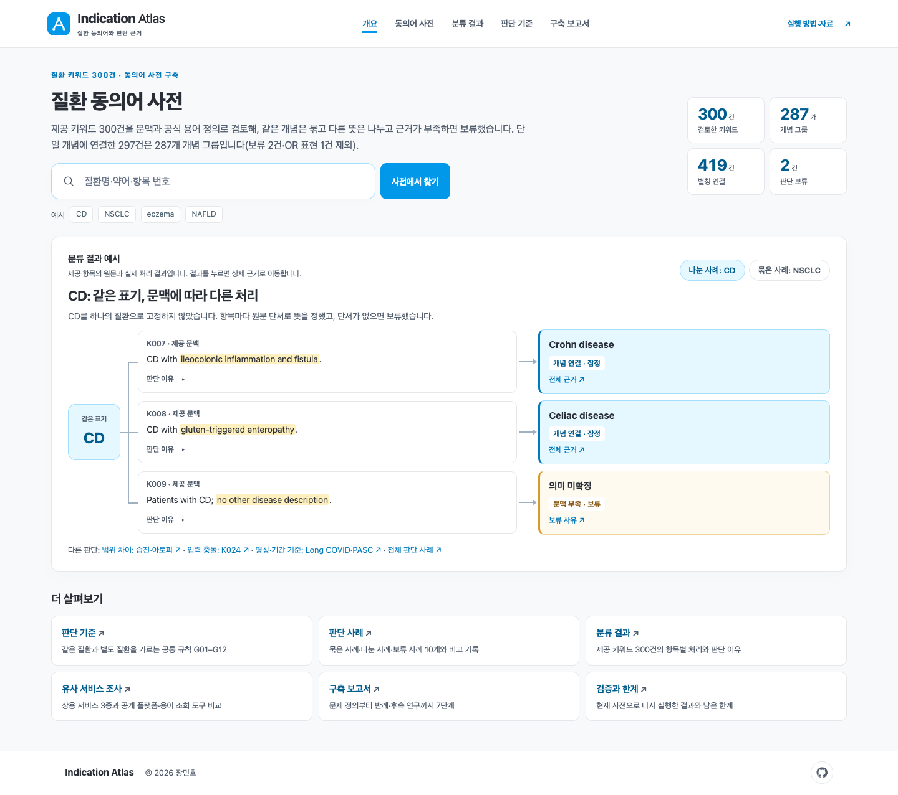
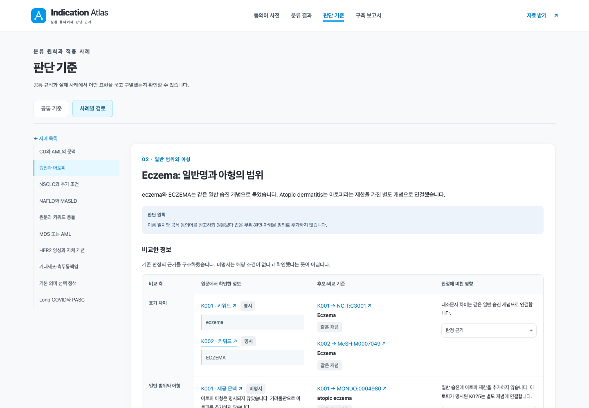

# Indication Atlas

300개 질환 표현의 개념 연결·동의어·판단 근거를 탐색하는 제출용 정적 웹입니다.

**로컬 실행:** `python3 tools/serve.py` → http://127.0.0.1:8787

**웹에서 확인:** [Indication Atlas](https://indication-atlas.netlify.app/)

**소스 저장소:** [minho00123/indication-atlas-submission](https://github.com/minho00123/indication-atlas-submission)



## 바로 확인하기

- **개요:** 첫 화면. 결과 요약, 분류 결과 예시(나눈 사례: CD / 묶은 사례: NSCLC)의 연결 그림, 판단 기준·사례·조사·보고서 안내.
- **동의어 사전:** 개념 검색, 연결된 이름에서 근거로 이동.
- **분류 결과:** 전체 판정표와 원문·이유·출처.
- **판단 기준:** 공통 규칙 G01–G12와 범위 차이·문맥·OR 조건·입력 충돌의 적용 사례.
- **구축 보고서:** 구축 과정, 유사 서비스 조사, 검증과 한계, 파일과 실행 방법.

현재 데이터는 300행입니다. 보류 2건과 OR 표현 1건을 제외한 297개 항목을 287개 개념 그룹에 연결했고, 별칭 연결은 출처 항목별 419건(정규화한 서로 다른 검색 표현 404개)입니다. 개념 그룹에는 질환군·소견·상태도 포함됩니다. 연구용 판정이며 임상 전문가 승인이나 독립 정확도 평가를 거치지 않았습니다.



## 실행과 검사

Python 3.9 이상, 표준 라이브러리만 사용합니다.

```bash
python3 tools/serve.py
python3 tools/build.py
python3 tools/dataset.py --term CD
python3 tools/score_legacy.py
python3 tools/verify_supplement.py
python3 -m unittest discover -s tests -p 'test_*.py'
```

`serve.py`는 빌드한 뒤 로컬 서버를 시작합니다. 결과는 `dist/`이며 Git에는 생성 파일 대신 소스와 기준 데이터를 올립니다. 네트워크·계정·모델 API 없이 빌드할 수 있습니다.

분석 엔진 검사는 Node.js 22에서 `node --test tests/test_*.mjs`로 실행합니다(선택). 작성자가 구성한 개발·반례 입력 103건을 자동 테스트와 브라우저 검사로 확인합니다. 지원 범위는 [분석 엔진 문서](docs/ANALYZER.md)에 있습니다.

300건을 현재 사전으로 다시 실행한 결과를 재현하려면 Node.js 22에서 `node tools/run_rule_audit.mjs --check`를 실행합니다. Python 빌드는 저장된 결과의 입력 해시·집계를 검증하며 새 의학 판정을 생성하지 않습니다. 자세한 내용은 [검증 방법과 재실행](docs/RULE_AUDIT.md)에 있습니다.

## Netlify 연동

1. 이 폴더를 GitHub 저장소의 루트로 올립니다.
2. Netlify에서 해당 저장소를 가져옵니다.
3. 기본 브랜치 `main`, 빌드 명령 `python3 tools/build.py`, 게시 폴더 `dist`를 사용합니다.

설정은 [netlify.toml](netlify.toml)에 포함돼 있습니다. [공식 배포 안내](https://docs.netlify.com/deploy/create-deploys/). 로그인·DB·실행 중 모델 호출은 사용하지 않습니다.

## 구성

| 경로 | 내용 |
|---|---|
| app/ | HTML·CSS·JavaScript 화면 |
| data/ | 원본 XLSX, 고정 판정·사전·출처, 초기 실험 입력·예측 |
| evidence/ | 공식 API 응답 676개와 MONDO 사용 항목·웹 발췌 |
| docs/ | [가이드라인](docs/GUIDELINES.md), [유사 서비스 조사](docs/SERVICE_RESEARCH.md), [구축 과정](docs/METHODOLOGY.md), [AI 교차 검토 기록](docs/AI_REVIEW.md), [실행법](docs/RUN.md) |
| tools/ · tests/ | 독립 실행·검증 코드 |

## 데이터와 출처

제공된 XLSX는 수정하지 않았습니다. `data/manifest.json`에 기준 파일 해시가 있고 빌드 시 확인합니다. `data/records.json`은 근거를 대조해 작성한 고정 판정입니다. 빌드가 판정을 다시 추론하는 것은 아닙니다.

MONDO v2026-10-06 사용 항목을 발췌했으며 전체 온톨로지를 포함하지 않습니다. [MONDO 공식 릴리스](https://github.com/monarch-initiative/mondo/releases/tag/v2026-10-06), [MONDO 귀속·이용 안내](https://mondo.monarchinitiative.org/pages/download/). NCIt는 NCI EVS, MeSH는 NLM, HPO는 Jackson Laboratory의 공식 응답을 보존했습니다. 자료별 URL·시각·원본 해시는 `evidence/api-manifest.json`과 `data/sources.json`에서 추적합니다.

대표 10개 사례의 비교 축·후보별 관계·최종 처리와 원문 근거를 구조화했습니다. [구축 과정](docs/METHODOLOGY.md)에는 현재 검토 기록과 후속 연구를, [외부 기준선](docs/EXTERNAL_BASELINES.md)·[임상시험 탐색](docs/EXTERNAL_TRIALS.md)에는 과거 보조 분석과 한계를 정리했습니다. 보조 분석은 현재 사전의 성능 평가가 아닙니다.

AI를 후보 탐색·초안·구현·교차 검토에 사용했고, 검토 의견은 원문과 공식 자료로 대조해 반영했습니다([AI 교차 검토 기록](docs/AI_REVIEW.md)). 초기 실험의 재채점 자료와 한계는 [구 정책 실험 기록](docs/LEGACY_EXPERIMENT.md)에 따로 보존했습니다.
